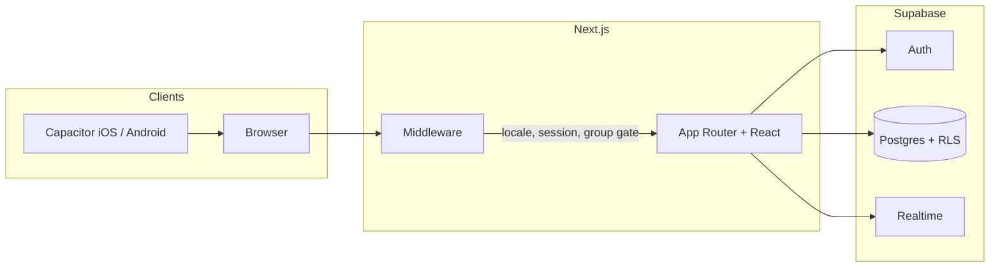

# Centrale Vegas

All the fun of prediction markets, none of the financial risk. You open a market, people bet points, odds move, a referee settles it.

**Virtual points only.** No real money, no payouts.

Live: [centralevegas.com](https://centralevegas.com)

https://github.com/user-attachments/assets/ee1a80c9-53be-4188-97b0-db5a6311aa4b

## How it works

Create a group and invite your friends. Everyone starts with 200 points. Anyone in the group can open a market: a question, 2 to 6 answers, a deadline, and a **referee** who will pick the winning answer.

Odds start even and move as bets come in. Your multiplier is **locked when you bet**, then paid out when the referee decides. You can place multiple bets until the deadline.

- To incentivize market creation, the person who created the market gets a 10% commission on the pool.
- To limit insider trading or manipulation, you can exclude a member from a given market (e.g. Evan for "Will Evan be late?").
- A referee can close betting at any time, but can only settle once at least two people have bet.
- For moderation (harassment, cheating, ...), a user can be banned.

Typical student uses: "who shows up late", "which team wins", "will the bus be on time". The things people already argue about in a group chat.

## Features

- **Groups:** public join or application with a message; invite link; creator can kick members; one group per account; **200 points** on join
- **Markets:** title, 2-6 answers, deadline; a designated referee (any member); optional **exclusion list** so some members can see the market but cannot bet (conflict of interest, the person the question is about, etc.)
- **Referee:** can close betting early; cannot settle until at least two different people have bet; then picks the winning answer
- **Wallet:** total points vs points locked in open markets; leaderboard and profiles are scoped to the current group
- **Live:** new bets stream in; a chart of implied probabilities; activity feed
- **FR / EN**

Banned users are frozen out of the home feed. An `/admin` screen exists for operators.

## Odds

Each option starts with `50` points of virtual liquidity, so a new market already has defined odds. The multiplier you get on option *i* is:

```text
m_i = (T + s · b) / (B_i + s · b)
```

- `T`: pool on all options (including virtual liquidity), before your bet
- `B_i`: pool on option *i*, before your bet
- `b`: your stake (`0` when just displaying current odds)
- `s`: slippage, default `0.5`

A bigger bet on *i* pulls `m_i` down. Slippage stops a whale from locking a free price. Implementation: [`src/lib/utils/bet-multiplier.ts`](src/lib/utils/bet-multiplier.ts). Monte Carlo vs risk-free arbitrage: [`scripts/multiplier-analysis.py`](scripts/multiplier-analysis.py).

On settlement, winners receive profit `stake × (m − 1)` and losers lose their stake. Both use the multiplier stored on the bet row, not a recomputation after the fact.

## Stack

Next.js 16 (App Router) · TypeScript · Tailwind · shadcn/ui · Supabase (auth, Postgres, realtime) · Capacitor 7 (iOS / Android shells)



Middleware prefixes `/en` or `/fr`, requires a session, and checks group membership before a market page. The UI talks to Supabase from the browser (auth cookies, Postgres, live bet inserts). Capacitor wraps the same web app; it is not a separate native codebase.

```text
src/
  app/[locale]/          routes (home, market, groups, profile, leaderboard, admin, auth)
  components/            feature UI (`components/ui` = shadcn)
  lib/supabase/          browser / server / middleware clients
  lib/{user,group,balance}/
  lib/utils/bet-multiplier.ts
  middleware.ts          locale, auth, group membership on /bet/:id
public/locales/{fr,en}/
docs/demo.mp4            product walkthrough
supabase/migrations/     Postgres schema + RLS
scripts/                 offline multiplier analysis
android/  ios/           Capacitor projects
```

### Data model

Source of truth: [`supabase/migrations/20250216155933_init.sql`](supabase/migrations/20250216155933_init.sql). It creates the tables below, foreign keys, indexes, RLS, and adds them to `supabase_realtime`. No seed data.

| Table | Role |
| --- | --- |
| `Users` | profile (`username`, `bio`, `is_banned`, `has_seen_onboarding`), FK to `auth.users` |
| `Group` | name, description, `is_publicly_joinable`, `created_by` |
| `UsersGroupMembership` | user ↔ group (unique pair) |
| `RequestJoinGroup` | pending joins (+ message) |
| `BettingGame` | market (`title`, `group`, `deadline`, `referee`, `created_by`, `decided_at`) |
| `BettingOption` | answers (`title`, `game`, `is_winning`) |
| `Bets` | `user`, `game`, `option`, `amount`, **`multiplier`** (locked at bet time) |
| `UsersExcludedFrom` | members barred from betting on a given market |
| `PointsHistory` | group wallet (latest row = balance; default grant is 200) |
| `DecisionNotification` | "your market settled" inbox |

Most tables allow any authenticated user to read and write (RLS is on, policies are open). `/admin` is not a security boundary. Tighten policies before exposing a public instance.

## Getting started

You need Node 20+, pnpm, and a Supabase project with **email auth** enabled.

1. Run the schema in the Supabase SQL editor:

   [`supabase/migrations/20250216155933_init.sql`](supabase/migrations/20250216155933_init.sql)

2. Auth → URL configuration: add `{NEXT_PUBLIC_SITE_URL}/auth/callback` and the locale variants (`/en/auth/callback`, `/fr/auth/callback`).

3. Then:

```bash
pnpm install
cp .env.example .env
pnpm dev
```

Fill `.env` from Project Settings → API (`NEXT_PUBLIC_SUPABASE_URL`, `NEXT_PUBLIC_SUPABASE_ANON_KEY`). Never commit `.env`.

Open [http://localhost:3000](http://localhost:3000). Middleware prefixes `/en` or `/fr`.

On Vercel, set the same vars plus `NEXT_PUBLIC_ADMIN_USERNAMES` and, if you use it, `NEXT_PUBLIC_UMAMI_WEBSITE_ID`.

```bash
pnpm build
pnpm lint
pnpm type-check
```

`pnpm build:mobile` is `next build && pnpm cap sync`. The web app is a **server** Next.js app, not a static export. Treat iOS/Android as a starting point.

```bash
pip install -r scripts/requirements.txt
python scripts/multiplier-analysis.py
```

Known gaps: several screens are still large client components; bets are written from the browser, so a public instance should tighten the RLS policies in the migration (they currently allow any authenticated user).

## License

[MIT](LICENSE) © Fabien CLET
